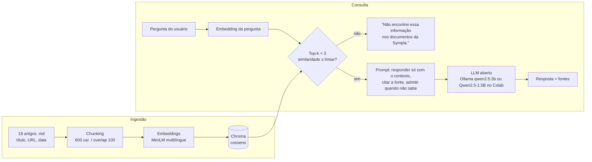

# Relatório – Assistente RAG da Central de Ajuda da Sympla

**Disciplina:** Tecnologias Emergentes – PUC-Campinas · **Atividade 4**
**Dupla:** Lucas ______ e ______ · **Data:** novembro de 2026

> Os trechos marcados com **[PREENCHER]** dependem dos números gerados ao rodar `avaliacao/avaliar.py` no Colab (arquivo `avaliacao/resultados/resultados.md`).

## 1. Problema e usuário

A Sympla é uma das maiores plataformas brasileiras de venda de ingressos e inscrições para eventos. Quem compra um ingresso costuma ter dúvidas repetitivas: prazo para cancelar, como funciona o reembolso em cada forma de pagamento, troca de titularidade, taxas, meia-entrada, parcelamento. As respostas existem na Central de Ajuda, mas estão espalhadas em dezenas de artigos, e o comprador precisa achar o artigo certo.

**Usuário:** o comprador de ingressos (e, secundariamente, a equipe de atendimento, que pode usar o assistente para responder chamados mais rápido).

**Por que RAG:** um LLM sozinho não conhece as regras atuais da Sympla e tende a inventar prazos e valores (por exemplo, "reembolso em 30 dias" ou "troca até 48 h antes"). O RAG busca primeiro os trechos certos da Central de Ajuda e manda o LLM responder só com eles, citando a fonte. Quando a base não tem a resposta, o sistema diz que não encontrou.

**Valor para o negócio:** menos chamados repetitivos no atendimento (o próprio artigo "Como falar com a Sympla" fala em retorno de até 1 dia útil, enquanto o assistente responde na hora), respostas consistentes com a política oficial e menor risco de informação errada sobre direitos do consumidor (prazo de arrependimento do CDC, reembolso).

## 2. Base de documentos

- **18 artigos públicos** da Central de Ajuda da Sympla (ajuda.sympla.com.br), em Markdown, na pasta `docs/`.
- Cada arquivo tem um cabeçalho com **título, URL de origem, data de atualização do artigo e data de acesso (13/11/2026)**.
- Coleta feita pela API pública da Central de Ajuda (Zendesk), convertendo o HTML em texto. Foram removidos elementos de navegação ("Esse artigo foi útil?", "Artigos relacionados"). O artigo de meia-entrada foi reduzido à parte nacional e a uma seleção das leis estaduais, por ser muito longo.
- Não há dados pessoais nem documentos confidenciais; os únicos contatos citados são canais públicos de atendimento.
- Temas cobertos: cancelamento e reembolso (5 artigos), reembolso por forma de pagamento, taxas, troca de titularidade, Seguro Reembolso Garantido, formas de pagamento, parcelamento, acesso aos ingressos, evento adiado/cancelado, exclusão de conta, canais de atendimento, compra por terceiros, como comprar e meia-entrada.

A lista completa com links está no README.

## 3. Arquitetura

Fluxo: os documentos são divididos em trechos, cada trecho vira um vetor e é guardado no Chroma. Na consulta, a pergunta vira um vetor, o Chroma devolve os 3 trechos mais parecidos e os que ficam abaixo do limiar são descartados. Se nenhum sobra, o sistema responde que não encontrou **sem chamar o LLM** (economiza tempo e elimina a chance de alucinação). Se sobra algum, o LLM recebe os trechos com a fonte de cada um.

Interfaces: linha de comando (`perguntar.py`), app web em Gradio (`app.py`) e notebook do Colab.

## 4. Escolhas técnicas e justificativas

### 4.1 Modelo de embeddings
`sentence-transformers/paraphrase-multilingual-MiniLM-L12-v2`: gratuito, treinado em mais de 50 idiomas (inclui português), pequeno (~120 MB, 384 dimensões) e rápido em CPU, o que permite rodar no Colab gratuito e no notebook de um aluno. O script também aceita `intfloat/multilingual-e5-small` para comparação (o código adiciona os prefixos `query:`/`passage:` que a família E5 exige). **[PREENCHER se rodarem a comparação.]**

### 4.2 Banco vetorial
Chroma: roda embutido no Python, sem servidor, persiste em disco e suporta distância de cosseno. Para 18 documentos (~110 trechos) é mais que suficiente.

### 4.3 Chunking e tamanho do trecho
O texto é dividido por parágrafos e agrupado até o tamanho-alvo; parágrafos maiores são quebrados por linha, frase e, em último caso, palavra. Cada trecho começa com o final do anterior (sobreposição), para não perder uma regra que caia na fronteira. O título do artigo e a seção são colocados na frente do texto **só no embedding**, o que ajuda trechos curtos ("Não. A troca é desabilitada 24 horas antes...") a serem achados.

Foram testados três tamanhos (sobreposição de ~15–20%):

| Configuração | Nº de trechos | Tamanho médio |
|---|---|---|
| 300 car. / overlap 60 | 217 | 247 car. |
| 600 car. / overlap 100 | 110 | 466 car. |
| 1000 car. / overlap 150 | 62 | 789 car. |

**[PREENCHER com a tabela de P@k, Hit@k e MRR de `resultados.md`.]**

Justificativa da escolha (ajustar conforme os números): trechos de 300 caracteres separam bem as regras, mas muitas vezes cortam a pergunta da resposta (nas FAQs, a pergunta fica num trecho e a resposta no outro) e o LLM recebe pouco contexto. Trechos de 1000 caracteres misturam vários assuntos do mesmo artigo (por exemplo, prazo de troca e custo da troca juntos), o que dilui o embedding e gasta mais contexto do LLM. **600 caracteres** costuma ficar no meio: um trecho cobre uma regra completa com o contexto ao redor. **[Confirmar com o resultado: escolher a configuração com maior MRR/Hit@3.]**

### 4.4 Valor de k e limiar
- **k = 3**: vários temas aparecem em mais de um artigo (o prazo de 7 dias está em 4 artigos), então trazer 3 trechos aumenta a chance de o certo estar presente, sem encher o prompt de um modelo pequeno.
- **Limiar de similaridade**: o script testa limiares de 0,20 a 0,80 e escolhe o que melhor separa perguntas com resposta das sem resposta (acurácia balanceada). **[PREENCHER com o limiar sugerido e a tabela de similaridades.]** O limiar é a primeira barreira contra perguntas fora da base; a segunda é o prompt, que manda o LLM recusar quando o contexto não responde.

### 4.5 LLM e prompt
- **Local:** Ollama com `qwen2.5:3b` (roda em CPU com ~4 GB de RAM).
- **Colab:** `Qwen/Qwen2.5-1.5B-Instruct` via transformers, em GPU T4 gratuita.
- A família Qwen2.5 foi escolhida por ser aberta, ter bom desempenho em português e seguir bem instruções em tamanhos pequenos. Temperatura baixa (0,1 / greedy) para respostas estáveis.
- O prompt de sistema exige: (1) responder só com o contexto, sem inventar valores ou prazos; (2) citar a fonte no formato `Fonte: título (arquivo, data)`; (3) responder exatamente "Não encontrei essa informação nos documentos da Sympla." quando o contexto não tiver a resposta; (4) português, no máximo 4 frases.

## 5. Avaliação

### 5.1 Metodologia
- **22 perguntas de teste** (`avaliacao/perguntas_teste.json`): 18 com resposta na base e **4 sem resposta** (telefone do SAC da Sympla, valor em reais da taxa de serviço, CEO da Sympla, bilheteria física).
- Para cada pergunta foi registrada a **frase de evidência** do documento que a responde. Um trecho recuperado é relevante se contém essa frase, o que torna o gabarito independente do tamanho do chunk.
- Métricas: **precision@k** (fração dos k trechos que são relevantes), **hit@k** (pelo menos um relevante no top-k) e **MRR** (posição do primeiro relevante). Como a maioria das perguntas tem um único trecho relevante, o P@3 máximo fica perto de 33%; por isso Hit@k e MRR complementam a análise.
- Perguntas sem resposta: verifica-se se o limiar descarta todos os trechos e, com `--gerar`, se o LLM responde que não encontrou.

### 5.2 Resultados
**[PREENCHER: colar a tabela "Comparação das configurações" e o resumo "Respostas geradas pelo LLM" de `resultados.md`.]**

### 5.3 Análise de três erros
**[PREENCHER com 3 casos reais da seção "Falhas" de `resultados.md`.]** Erros que esperamos encontrar, com base nos documentos (servem de guia):

1. **Pergunta que pode ser respondida por inferência:** "A Sympla tem bilheteria física?" Nenhum artigo diz isso, mas trechos sobre "pontos de venda autorizados" ficam com similaridade alta e podem passar do limiar. Risco: o LLM deduzir uma resposta. Correção possível: endurecer o prompt, subir o limiar ou incluir um artigo que trate do tema.
2. **Informação repetida em vários artigos:** o prazo de 7 dias aparece em 4 artigos com redação diferente, e a regra de "48 horas" aparece com dois sentidos (recomendação ao comprador e prazo do organizador para responder). O top-3 pode trazer só trechos sobre as 48 horas, e o LLM confundir os dois prazos.
3. **Pergunta e resposta separadas pelo chunking:** nas FAQs ("Posso fazer mais de uma troca? Não. É permitida somente uma troca...") um chunk pequeno pode separar a pergunta da resposta. O trecho recuperado parece relevante, mas não contém a regra.
4. **Vocabulário diferente:** o usuário fala "trocar o nome do ingresso" e o documento fala "titularidade"; o usuário fala "SAC" e o documento fala "atendimento". Embeddings multilíngues pequenos às vezes não aproximam esses termos.

## 6. Limitações e riscos

- **Base pequena e datada:** 18 artigos copiados em 13/11/2026. Se a Sympla mudar uma política, o assistente fica desatualizado até reindexar. Em produção seria preciso sincronizar com a API da Central de Ajuda periodicamente.
- **Políticas que dependem do evento:** muitas regras são definidas pelo organizador (política de cancelamento, troca de titularidade). O assistente só conhece a regra geral e deve orientar o usuário a conferir a página do evento.
- **Alucinação residual:** mesmo com o prompt, um LLM pequeno pode misturar trechos ou inventar detalhes. A citação de fonte permite conferir.
- **Assuntos jurídicos:** respostas sobre CDC e meia-entrada não substituem orientação jurídica; leis regionais foram resumidas.
- **Limiar fixo:** um único limiar não serve igualmente para todas as perguntas; perguntas curtas tendem a ter similaridade mais baixa.
- **Avaliação limitada:** 22 perguntas escritas pela própria dupla, com risco de viés (as perguntas usam termos parecidos com os do texto).
- **Uso da marca:** projeto acadêmico, não oficial; os textos são da Sympla e foram usados só para estudo.

## 7. Divisão do trabalho na dupla

**[PREENCHER]** Sugestão de divisão:

| Integrante | Responsabilidades |
|---|---|
| Lucas | coleta e preparação dos documentos, chunking e índice, avaliação e análise de erros |
| Colega | prompt e integração com o LLM (Ollama/Colab), interfaces (CLI e Gradio), relatório e demonstração |

## 8. Como reproduzir

Ver o passo a passo no `README.md` (Colab ou local com Ollama).
